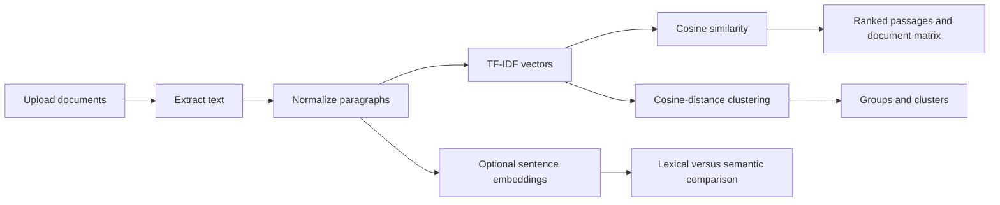

# Project overview

## Problem and scope

**Assignment Similarity Checker** helps a human reviewer locate similar
passages among assignments. It does not decide whether plagiarism occurred and
does not output a probability of copying. The prototype supports TXT, PDF,
DOCX, and OCR-enabled common image files.

## Processing pipeline

Text extraction preserves PDF page order. OCR is optional and requires the
Tesseract executable. Empty or unreadable files are reported individually.

## Algorithms

For term `t`, document `d`, and corpus `D`, TF-IDF is
`tf(t,d) * log(|D| / (1 + df(t)))`. The cosine similarity of vectors `x` and
`y` is `(x · y) / (||x|| ||y||)`. The app displays lexical cosine similarity
as `100 * cosine` percent. This is a similarity score, not a copying
probability. The optional semantic tab uses normalized sentence embeddings and
displays their signed cosine score scaled by 100. Hierarchical clustering uses
average linkage over cosine distance `1 - cosine`. Connected groups are graph
components: an indirectly connected pair can be in one group without meeting
the threshold directly.

## Data and evaluation

`sample_data/demo/` contains original synthetic documents for a live
demonstration. `docs/test_pairs.csv` is a 60-row illustrative benchmark
(36 train, 12 validation, 12 test) with train, validation, and test splits. Its labels are starter annotations,
not independent human validation of real student work. The evaluator selects
thresholds on validation data and reports held-out test precision, recall,
F1, accuracy, specificity, balanced accuracy, and confusion counts.

## GTU Data Mining Techniques mapping

| Topic | Implemented here | Future extension |
|---|---|---|
| Preprocessing | whitespace normalization, paragraph splitting, TF-IDF | richer language-specific normalization |
| Text mining | TF-IDF, shared-word inspection, optional embeddings | plagiarism-source retrieval |
| Clustering | connected components and average-linkage clustering | reference labels and stability studies |
| Evaluation | validation threshold selection and held-out metrics | larger reviewed benchmark and cross-validation |

## Limitations

Scores can be affected by common prompts, citations, technical vocabulary,
document length, and OCR quality. The semantic model may require a first-use
download and can truncate long paragraphs. Clusters are exploratory, and the
small illustrative benchmark cannot support production accuracy claims.
